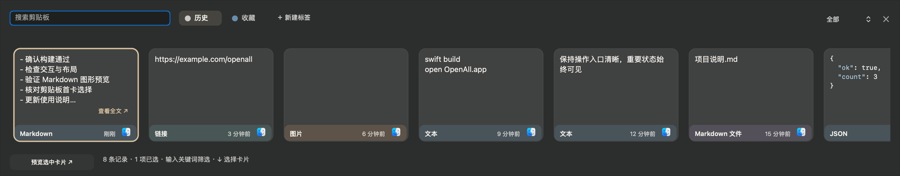
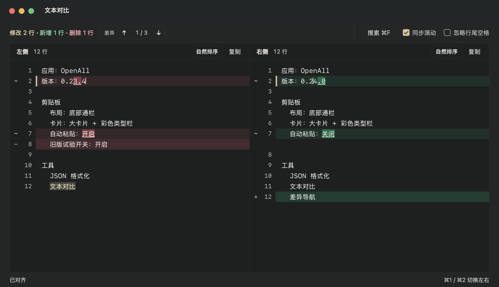
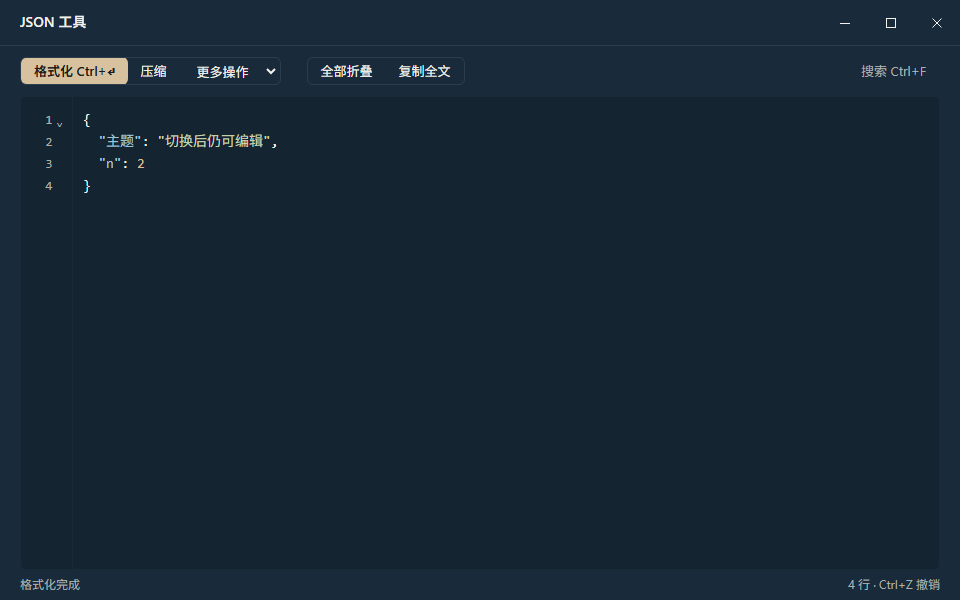
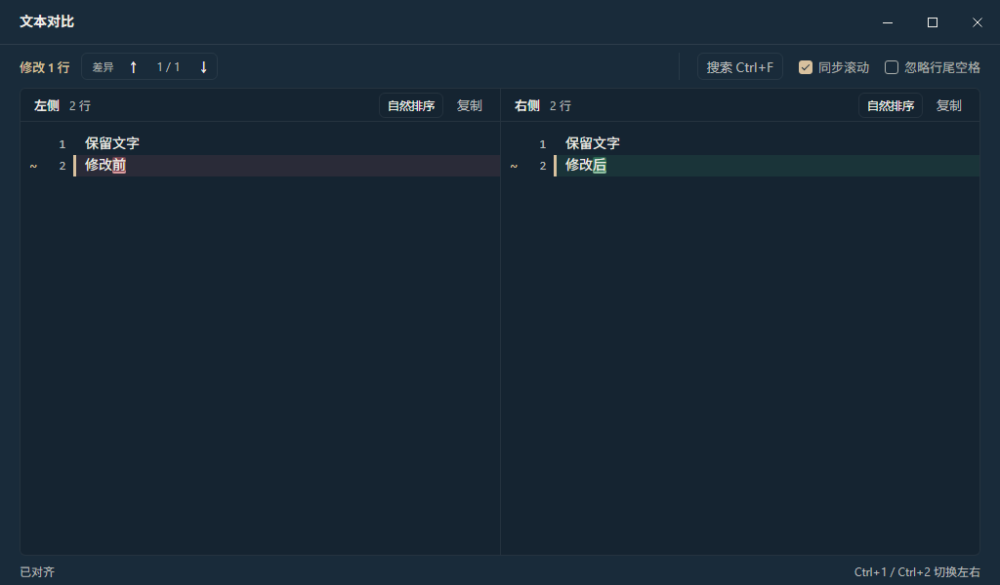

# OpenAll

搜索、剪贴板与常用开发工具，集中在一个桌面应用里。

OpenAll 支持 **macOS 和 Windows**。用快捷键搜索应用、文件或工具；从剪贴板选取内容，直接送回正在编辑的 JSON、文本对比或其他窗口。

[下载安装](#下载安装) · [功能](#功能) · [使用指南](docs/usage.md) · [开发指南](docs/development.md) · [反馈问题](https://github.com/innoerL/OpenAll/issues)

## 下载安装

当前版本：**0.26.2**。安装包和 SHA-256 校验文件见 [Releases](https://github.com/innoerL/OpenAll/releases/latest)。

| 平台 | 安装包 | 运行要求 |
| --- | --- | --- |
| macOS | [下载通用版](https://github.com/innoerL/OpenAll/releases/download/v0.26.2/OpenAll-macOS-0.26.2.zip) | macOS 13 或更新版本，Intel / Apple Silicon |
| Windows | [下载安装版](https://github.com/innoerL/OpenAll/releases/download/v0.26.2/OpenAll-Windows-0.26.2-x64-setup.exe) | Windows x64 |

macOS 解压后将 `OpenAll.app` 放入“应用程序”；Windows 双击安装器，按向导完成安装。安装包尚未经过 Apple 公证或 Windows 代码签名，系统可能提示未知开发者。

打开应用后，通过菜单栏／系统托盘进入设置。默认使用 macOS `⌘Space`、Windows `Ctrl+Space` 唤起搜索；输入 `?` 浏览全部功能。快捷键可在设置中修改。

## 功能

| 工具 | 可以做什么 |
| --- | --- |
| 金价 | 输入“金价”打开桌面浮窗：国际现货、周大福牌价、近一年曲线、三币种、七日展望与实际预测验证；保留贴边收起、悬停展开和置顶。[使用说明](shared/gold-core/README.md) |
| 搜索 | 应用与文件搜索、拼音与首字母、精确匹配、拼写纠错、网址别名、常用片段。支持 `文件 报告`、`文档 报告`、`图片 截图`、`json 配置` 等类型限定。 |
| 剪贴板 | 屏幕底部通栏、大卡片和彩色类型栏；文本、图片、文件、收藏与标签；图片文字搜索、全文预览、双卡对比和跨工具粘贴。 |
| JSON | 在同一区域格式化与编辑，支持行号、折叠、查找、压缩、转义、键名自然排序和撤销。 |
| 文本对比 | 左右原位编辑，突出增删行及行内字符差异；支持自然排序、搜索、差异跳转与同步滚动。 |
| 文本与开发 | Markdown / Mermaid、Unicode、SQL / YAML / Properties 格式化、结构化配置对比、日志时间线、SQL 参数还原、执行计划阅读。 |
| 常用工具 | 图片裁剪、旋转与格式转换，时间戳、日期、Cron、ASCII、身份证测试号、内嵌翻译、复制堆栈与选中内容操作。 |

剪贴板、设置等数据保存在本机。翻译、更新检查等联网功能使用相应外部服务；浏览器历史和文件搜索可按需开启。

## 界面

**剪贴板 · macOS**



**文本对比 · macOS**



<details>
<summary>查看 Windows 界面</summary>

Windows 使用右上角窗口按钮；标题栏、内容区和输入框跟随主题颜色。





</details>

截图使用示例内容，来自实际应用。

<details>
<summary>查看金价工具</summary>

输入“金价”打开。以下为离线验收样例，包含合并曲线和独立深色模式。


</details>

## 从源码运行

```sh
git clone https://github.com/innoerL/OpenAll.git
cd OpenAll
```

### macOS

安装 Xcode Command Line Tools 和 Python 3，然后运行（首次构建会下载并校验内置金价运行组件）：

```sh
zsh macos/scripts/build.sh
open macos/.build/OpenAll.app
```

默认构建 Intel 与 Apple Silicon 通用应用。预构建的离线编辑器资源已包含在仓库中；修改编辑器后需使用 Node.js 重建，见 [macOS 构建说明](macos/README.md)。

### Windows

安装 Node.js 22，然后运行：

```sh
cd windows
npm ci
npm start
```

在 Windows 上生成安装包：

```sh
npm run dist -- --publish never
```

更多检查命令与云端构建说明见 [开发指南](docs/development.md)，本次发布的实际验收记录见 [发布验证](docs/verification.md)。

## 反馈与贡献

通过 [Issues](https://github.com/innoerL/OpenAll/issues) 提交问题或建议。反馈时请附上版本、系统、复现步骤和预期行为；示例内容请先去除私人信息。

参与开发前请阅读 [CONTRIBUTING.md](CONTRIBUTING.md)；编码代理请遵循 [AGENTS.md](AGENTS.md)。

## 许可证

项目自有代码暂未指定开源许可证。第三方依赖保留各自许可证，详见 [THIRD_PARTY_NOTICES.md](THIRD_PARTY_NOTICES.md)。
